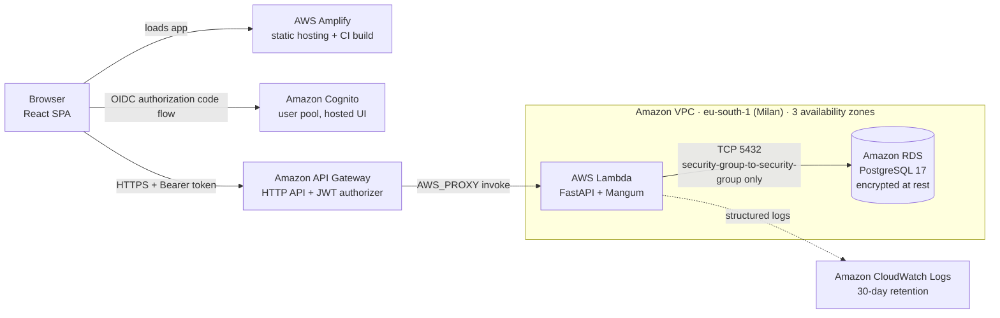

# WellBeat

**Serverless cardiovascular risk stratification on AWS, integrating ApoB and environmental stressors.**

WellBeat estimates a person's 10-year risk of heart attack or stroke from a routine blood test. It adds two things standard calculators leave out: an estimate of **Apolipoprotein B (ApoB)**, a stronger cholesterol marker that normally needs an extra, expensive lab test, and **air pollution** as a risk factor inside the model. The whole platform runs serverless on AWS.


> Published and presented at **SoftCOM 2026**, the 34th International Conference on Software, Telecommunications and Computer Networks, Split, Croatia, September 2026.
>
> WellBeat is a research prototype. It is not a medical device and must not be used for diagnosis or treatment decisions.


---

## Contents

- [Why WellBeat](#why-wellbeat)
- [Features](#features)
- [Architecture](#architecture)
- [Risk model](#risk-model)
- [Tech stack](#tech-stack)
- [Security and privacy engineering](#security-and-privacy-engineering)
- [Performance](#performance)
- [Operations case study: incident recovery and hardening](#operations-case-study-incident-recovery-and-hardening)
- [API reference](#api-reference)
- [Getting started](#getting-started)
- [Deployment](#deployment)
- [Repository structure](#repository-structure)
- [Roadmap](#roadmap)
- [Limitations](#limitations)
- [Publication](#publication)
- [Acknowledgements](#acknowledgements)
- [Author](#author)
- [License](#license)

---

## Why WellBeat

Cardiovascular disease is the leading cause of death worldwide, with about 17.9 million deaths every year. Risk builds for years without symptoms, and the first sign is often the event itself.

Standard risk calculators such as the Framingham Risk Score work with age, sex, cholesterol, blood pressure, smoking and diabetes. They are well validated, but they miss two things:

1. **How many particles carry the cholesterol.** LDL cholesterol measures mass. ApoB counts the atherogenic particles, and it predicts residual risk better. The direct test is expensive and rarely part of routine screening.
2. **Where the person lives.** Chronic exposure to fine particulate matter (PM2.5) is an established, independent cardiovascular risk factor.

WellBeat closes both gaps without asking the patient for anything beyond a standard lipid panel, height and weight.

## Features

- **10-year cardiovascular risk** from a continuous Framingham Cox model, with a Low / Intermediate / High category.
- **Estimated ApoB** with the Hwang Model 2 equation, from LDL-C and BMI. No extra lab test and no extra cost.
- **Exposome term**: a pollution penalty applied inside the model's linear predictor, not as a note beside the result.
- **Heart age**: the calculated risk expressed as an age, which is easier to understand than a percentage.
- **7-axis risk breakdown**: a radar chart showing whether risk comes from biochemistry, lifestyle or environment.
- **Counterfactual recommendations**: the engine re-runs the model with one factor changed and reports the difference, for example "Quitting smoking could lower your 10-year risk by 19.8%".
- **Suggested re-assessment interval** based on the risk level, from every 6 months to every 5 years.
- **Assessment history and trend view** for each user.
- **Tiered consent gateway** (Essential, Functional, Marketing) with only essential processing enabled by default.
- **Secure sign-in** with Amazon Cognito and short-lived tokens.

<table>
  <tr>
    <td width="38%"></td>
    <td></td>
  </tr>
  <tr>
    <td align="center"><sub>Input form, values from a standard blood test</sub></td>
    <td align="center"><sub>Result: risk, ApoB, BMI, heart age, breakdown and action plan</sub></td>
  </tr>
</table>

---

## Architecture



**Request lifecycle**

1. The user signs in through the Cognito hosted UI (OIDC authorization code flow, `oidc-client-ts`).
2. The React app validates every input with a Zod schema that mirrors the server schema, so invalid data never leaves the browser.
3. The request goes to the API Gateway HTTP API with the user's token. A JWT authorizer checks issuer and audience **before** any compute runs; unauthenticated calls are rejected at the edge with HTTP 401.
4. API Gateway invokes the Lambda function, where FastAPI (through the Mangum ASGI adapter) validates the body again with Pydantic. Out-of-range values return HTTP 422.
5. The risk engine computes the result, stores it in PostgreSQL and returns the response.
6. The database accepts connections only from the Lambda security group. It has no public ingress, and the function needs no route to the internet.

---

## Risk model


### 1. Baseline: Framingham continuous model

$$
P_{10} = 1 - S_0^{\exp\left(\sum_i \beta_i X_i \;-\; \bar{L}\right)}
$$

$X_i$ are ln(age), ln(total cholesterol), ln(HDL-C), ln(systolic blood pressure), current smoking and diabetes. The sex-specific coefficients $\beta_i$, the mean linear predictor $\bar{L}$ and the baseline survival $S_0$ follow the Framingham general cardiovascular risk profile ([D'Agostino et al., 2008](https://pubmed.ncbi.nlm.nih.gov/18212285/)):

| Sex | $\bar{L}$ | $S_0$ |
|---|---|---|
| Male | 23.9802 | 0.88936 |
| Female | 26.1931 | 0.95012 |

### 2. ApoB estimation: Hwang Model 2

$$
\text{ApoB}_{\text{est}} = -49.13 + 0.70 \cdot \text{LDL-C} + 21.81 \cdot \ln(\text{BMI})
$$

LDL-C in mg/dL and BMI in kg/m². The equation was selected from 23 candidate formulas in a 2025 comparative analysis of a large South European cohort ([Fogacci et al., 2025](https://doi.org/10.1016/j.atherosclerosis.2025.119178)), because it was the most reliable for that population ([Hwang et al., 2012](https://www.ncbi.nlm.nih.gov/pmc/articles/PMC3526603/)).

### 3. Exposome: pollution penalty

$$
L_{\text{adj}} = \sum_i \beta_i X_i + \delta_{\text{poll}}, \qquad
\delta_{\text{poll}} = \ln(HR_{\text{poll}}) \cdot \mathbb{1}\left[E_{PM} > 50 \text{ days/year}\right]
$$

$E_{PM}$ is the number of days per year above the WHO 24-hour PM2.5 guideline. The penalty is added to the linear predictor, so it scales with the rest of the model instead of multiplying the final probability. $HR_{\text{poll}}$ is set equal to the hazard ratio for current smoking. This is a **conservative upper bound and a stated modelling assumption**, not a fitted value.

### 4. Further terms and outputs

| Term | Implementation |
|---|---|
| BMI | `weight_kg / height_m²`; overweight and obese ranges add a term to the linear predictor |
| Arrhythmia | Boolean flag that adds a term to the linear predictor |
| Heart age | Category-based offset from chronological age |
| Recommendations | Counterfactual re-runs of the model (smoking, blood pressure) plus rule-based guidance (ApoB, BMI, pollution, diabetes) |
| Re-assessment interval | 6 months (High), 12 months (Intermediate), 5 years (Low) |

### Input contract

Validated on both sides: Pydantic on the server is the source of truth, and Zod on the client mirrors it.

| Field | Type | Valid range |
|---|---|---|
| `age` | integer | 20 to 100 years |
| `gender` | string | `male` / `female` |
| `height` | float | 50 to 250 cm |
| `weight` | float | 11 to 300 kg |
| `systolic_bp` | integer | 60 to 250 mmHg |
| `ldl` | integer | 10 to 500 mg/dL |
| `hdl` | integer | 5 to 150 mg/dL |
| `smoker`, `diabetes`, `family_history`, `arrhythmia`, `high_pollution_exposure` | boolean | |

---

## Tech stack

| Layer | Technology |
|---|---|
| Frontend | React 19, Vite, Zustand, Zod, Recharts, oidc-client-ts |
| Hosting and frontend CI | AWS Amplify (builds on every push to `main`) |
| Authentication | Amazon Cognito user pool, OIDC authorization code flow |
| API | Amazon API Gateway HTTP API with a JWT authorizer |
| Compute | AWS Lambda, Python, FastAPI, Mangum, Pydantic |
| Data | Amazon RDS for PostgreSQL 17, SQLAlchemy, psycopg2 |
| Network | Amazon VPC, security groups, Lambda ENIs across 3 availability zones |
| Observability | Amazon CloudWatch Logs and metrics |
| Load testing | Grafana k6 |
| Region | `eu-south-1` (Milan), so health data stays in the EU |

---

## Security and privacy engineering

Health data is special-category data under the GDPR, so the platform is designed around keeping it contained.

| Control | How it is implemented |
|---|---|
| Network isolation | The Lambda function runs inside the VPC. The database security group accepts port 5432 **only** from the Lambda security group; there is no public ingress. The function has no internet route and needs none: it makes no outbound calls. |
| Authentication at the edge | A JWT authorizer on `ANY /{proxy+}` validates every token at API Gateway, so unauthenticated requests never reach compute. |
| Defence-in-depth validation | Zod in the browser and Pydantic on the server enforce the same bounds. The server always re-validates and answers HTTP 422. |
| No secrets in code | Database settings are injected at runtime through environment variables. Credentials were rotated after the move. |
| No health data in logs | SQLAlchemy runs with `hide_parameters=True`, so a failed query never writes patient values into CloudWatch. Logs expire after 30 days. |
| CORS allow-list | Restricted to the real frontend origin at both API Gateway and FastAPI. |
| Connection guardrail | Reserved concurrency of 20 × at most 5 pooled connections per environment caps the worst case at about 100 connections, below the limit of the database instance. |
| Encryption | HTTPS in transit; RDS storage encrypted at rest with AWS KMS. |
| Consent | Three consent tiers; only essential processing is on by default, and refusing the optional tiers does not block the assessment. |
| Regulatory position | A tool returning a personal risk score with advice would likely be Class IIa software under the EU MDR (Rule 11). This build is a research prototype, not placed on the market, and shows a non-diagnostic disclaimer. |

---

## Performance

Measured with Grafana k6 against the deployed production stack, not a local copy.

| Metric | Result |
|---|---|
| p95 latency at 100 concurrent virtual users | 101.5 ms |
| Requests served in that run | 12,576 |
| Availability in that run | 99.31% |
| Warm request, end to end | about 0.1 s (9 to 15 ms Lambda duration) |
| Cold start, end to end | about 3.2 s, most of it in the Lambda init phase |
| Latency cost of moving into the VPC | none measurable |

**Finding the real bottleneck.** An earlier, heavier load test failed for most requests. A later analysis of the CloudWatch metrics from that day showed the cause was not the database:

- Lambda `Errors` was **zero** for the whole day, so the application never failed.
- API Gateway 5xx responses were **exactly equal** to Lambda `Throttles`, request for request.
- Peak concurrent executions sat at **10**, the account-level concurrency quota at the time.

The failing requests never reached the database. The ceiling was the compute tier's account quota, since raised to 1000, with a deliberate reserved-concurrency cap added to protect the database.

---

## Operations case study: incident recovery and hardening

In September 2026 the AWS account was suspended for billing when the Free Tier allowance ended. During the suspension AWS disabled the KMS key that encrypted the database, and the RDS instance entered the terminal `inaccessible-encryption-credentials` state. After the account was reinstated, the web app loaded but every assessment failed with HTTP 500.

**Recovery**

1. Confirmed the KMS key was enabled again and found the latest system snapshot.
2. Restored the snapshot to a new RDS instance and rotated the master password.
3. Traced the HTTP 500 through CloudWatch to a connection string hardcoded in the source, still pointing at the old endpoint.
4. Moved all configuration to environment variables and redeployed, verifying each change before the next.
5. Verified end to end with a synthetic patient and hand-checked the results against the published formulas.

**Hardening done in the same work**

| Area | Before | After |
|---|---|---|
| Configuration | Endpoint and password in source code | Runtime environment variables; password rotated |
| Destructive route | A `GET /reset-db` route that dropped all tables | Removed |
| Database exposure | Port 5432 open to `0.0.0.0/0` | Reachable only from the Lambda security group |
| Lambda networking | Outside the VPC, reaching RDS over the internet | Inside the VPC, 3 availability zones |
| Logging | Failed queries wrote full health records into logs; no retention | `hide_parameters=True`; 30-day retention |
| CORS | `*` with credentials | Single origin allow-list at gateway and app |
| Connection pool | 1 connection, 1-hour recycle | 2 + 3 overflow, 5-minute recycle, pre-ping |
| Concurrency | Account quota of 10 throttling traffic | Quota 1000, reserved concurrency 20 |
| Client validation | Inconsistent hand-written checks | Zod schema mirroring the server |
| Sign-out | Broken: OIDC logout flow unsupported by Cognito | Cognito `/logout` endpoint with a registered sign-out URL |
| History loading | Race condition: a duplicate request without a token could blank the history | Single authorised request, one retry after token refresh, visible error banner |

The network change was done with zero downtime: the new private path was opened and verified first, and only then was the public rule removed, with a rollback ready at every step.

**Lessons applied**

- Billing alerts and budgets are part of availability, not only cost control.
- A customer-managed encryption key needs monitoring, because losing access to it makes the database unrecoverable.
- Keep a manual snapshot before every risky change; system snapshots expire.
- Infrastructure that lives only in the console cannot be rebuilt quickly. Infrastructure as Code is the first item on the roadmap.

---

## API reference

All routes require `Authorization: Bearer <Cognito ID token>`. Requests without a valid token are rejected by API Gateway with HTTP 401.

### `POST /risk/static`

Computes a risk assessment and stores it.

```json
{
  "user_id": 999001,
  "age": 52,
  "gender": "male",
  "height": 178,
  "weight": 88,
  "smoker": true,
  "systolic_bp": 145,
  "ldl": 160,
  "hdl": 42,
  "diabetes": false,
  "family_history": false,
  "arrhythmia": false,
  "high_pollution_exposure": true
}
```

Response for this synthetic patient:

```json
{
  "calculated_risk_score": "50.4%",
  "risk_category": "High",
  "bmi": 27.8,
  "heart_age": 62,
  "estimated_apo_b": 135.4,
  "recommendations": [
    "Quitting smoking could lower your 10-year CVD risk by 19.8%.",
    "Lowering your blood pressure to 120 mmHg could reduce your risk by 11.9%.",
    "Reaching a healthy weight can significantly reduce cardiac stress.",
    "High pollution acts like smoking. Consider air purifiers indoors and N95 masks on bad AQI days.",
    "Your estimated ApoB level is elevated. This is a strong, modern indicator of cardiovascular risk independent of standard cholesterol."
  ],
  "suggested_checkup": "Every 6 months",
  "message": "Result successfully saved to database."
}
```

### `GET /risk/history/{user_id}`

Returns the stored assessments for a user, newest first. Returns HTTP 404 when there are none.

| Status | Meaning |
|---|---|
| 200 | Success |
| 401 | Missing, invalid or expired token (API Gateway) |
| 404 | No history for this user |
| 422 | Input outside the valid ranges (Pydantic) |

---

## Getting started

### Prerequisites

- Python 3.12 or later (the deployed function runs on the Lambda Python runtime)
- Node.js 18 or later
- Docker, or a local PostgreSQL instance

### 1. Database

```bash
docker run -d --name wellbeat-pg \
  -e POSTGRES_DB=wellbeatdb \
  -e POSTGRES_USER=wellbeat \
  -e POSTGRES_PASSWORD=change-me \
  -p 5432:5432 postgres:17
```

### 2. Backend

```bash
cd backend/AWS/Lambda
python -m venv .venv
source .venv/bin/activate            # Windows: .venv\Scripts\activate
pip install fastapi mangum sqlalchemy psycopg2-binary pydantic uvicorn

export DB_HOST=localhost DB_PORT=5432 DB_NAME=wellbeatdb \
       DB_USER=wellbeat DB_PASSWORD=change-me \
       ALLOWED_ORIGINS=http://localhost:5173

python init_db.py                    # creates the risk_results table
uvicorn main:app --reload --port 8000
```

Interactive API docs are then available at `http://localhost:8000/docs`. Locally there is no API Gateway in front of the app, so the JWT check does not apply.

| Variable | Purpose |
|---|---|
| `DB_HOST`, `DB_PORT`, `DB_NAME` | PostgreSQL location |
| `DB_USER`, `DB_PASSWORD` | Database credentials |
| `ALLOWED_ORIGINS` | Comma-separated CORS allow-list |

The application refuses to start with a clear message if a required variable is missing.

### 3. Frontend

```bash
cd frontend
npm install
npm run dev                          # http://localhost:5173
```

The Cognito authority and client ID are configured in `frontend/src/main.jsx`, and the API base URL in `frontend/src/store/useHealthStore.js`. To sign in locally, add `http://localhost:5173/` to the Cognito app client's callback URLs and sign-out URLs.

---

## Deployment

| Component | Method |
|---|---|
| Frontend | AWS Amplify builds and deploys automatically on every push to `main` |
| Backend | Zip package uploaded to Lambda: `aws lambda update-function-code --function-name WellBeat-Risk-Engine --zip-file fileb://package.zip` |
| Configuration | Lambda environment variables |
| Infrastructure | Currently provisioned through the AWS console; moving to Terraform is the first roadmap item |

---

## Repository structure

```
.
├── backend/
│   └── AWS/Lambda/
│       ├── main.py                 # FastAPI app, risk engine, Lambda handler
│       ├── init_db.py              # schema initialisation
│       ├── stress_test.js          # k6 load test
│       ├── cold_start_bench.py     # cold and warm latency benchmark
│       ├── latency_test.py         # latency measurement
│       ├── acid_test.py            # transactional integrity checks
│       └── ...                     # model validation scripts
├── frontend/
│   └── src/
│       ├── components/             # layout, input form, dashboard, charts
│       ├── store/                  # Zustand store and API calls
│       ├── utils/validation.js     # Zod schema mirroring the server
│       ├── App.jsx
│       └── main.jsx                # OIDC / Cognito configuration
└── docs/images/                    # screenshots and figures
```

---

## Roadmap

**Platform**

- Infrastructure as Code with Terraform, with separate dev, staging and production environments
- CI/CD with GitHub Actions: lint, automated tests, build, deploy with approval gates
- Automated test suite: risk-engine regression vectors, API contract tests, end-to-end smoke tests
- RDS Proxy, Multi-AZ database, Secrets Manager with rotation, AWS WAF rate limiting
- Budget alarms and KMS key-state alarms

**Model**

- SCORE2 and SCORE2-OP, the European Society of Cardiology models, as the primary engine for European users
- Measured total cholesterol and triglycerides instead of an approximation
- Pollution exposure derived from the user's location (European Environment Agency or Copernicus data), aligned with the 2021 WHO guideline
- Literature-sourced coefficients for every additional term

**Product**

- Mobile application (React Native)
- Wearable integration through Apple Health and Android Health Connect, reading certified heart rhythm results, activity, blood pressure and weight
- HL7 FHIR export and import
- Doctor-ready PDF report and Italian localisation

---

## Limitations

- **Not clinically validated.** No discrimination or calibration metrics are reported, and there is no head-to-head comparison against QRISK3, SCORE2 or the Pooled Cohort Equations. Showing that the combined model predicts better requires prospective outcome data.
- **The pollution penalty is an assumption.** Its size is a conservative upper bound, not calibrated from exposure-response cohorts, and exposure is currently self-reported.
- **Some inputs are approximated.** Total cholesterol is estimated from LDL-C and HDL-C, and family history is collected but not yet used in the score.
- **Performance numbers describe software behaviour**, not clinical accuracy.

---

## Publication

A. Khatamsaz et al., "WellBeat: Serverless Cardiovascular Risk Stratification Integrating ApoB and Environmental Stressors," in *Proceedings of the 34th International Conference on Software, Telecommunications and Computer Networks (SoftCOM 2026)*, Split, Croatia, September 2026.

```bibtex
@inproceedings{khatamsaz2026wellbeat,
  title     = {WellBeat: Serverless Cardiovascular Risk Stratification Integrating ApoB and Environmental Stressors},
  author    = {Khatamsaz, Arman and others},
  booktitle = {Proceedings of the 34th International Conference on Software, Telecommunications and Computer Networks (SoftCOM 2026)},
  address   = {Split, Croatia},
  month     = sep,
  year      = {2026}
}
```

---

## Acknowledgements

This project was developed with the support of **LINKS Foundation** and **Mutua Privata**.

---

## Author

**Arman Khatamsaz** · Cloud and DevOps Engineer

[LinkedIn](https://www.linkedin.com/in/armankhatamsaz) · armankhatamsaz@outlook.com

---

## License

This repository is shared for portfolio and research purposes. No open-source license is granted: all rights reserved. Please contact the author for any other use.
